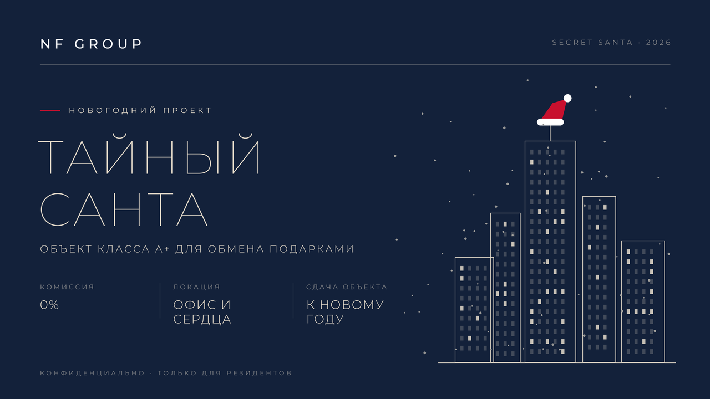
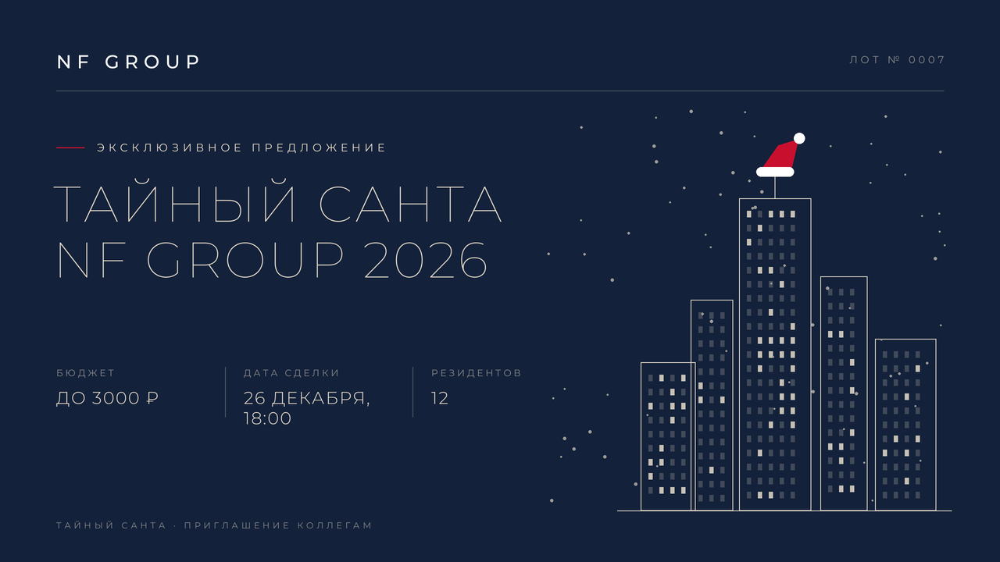
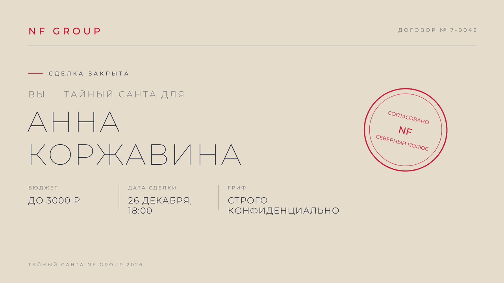
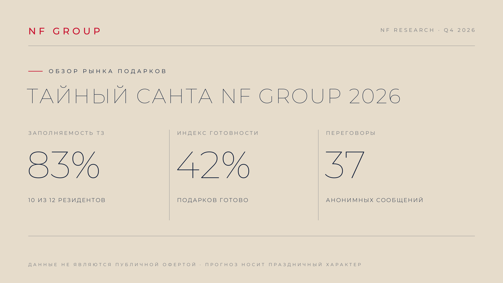

# 🎅 Тайный Санта NF Group — Telegram-бот

Новогодний «объект класса А+» для анонимного обмена подарками между коллегами.
Оформлен в фирменном стиле NF Group: тёмно-синий и бежевый, тонкий Montserrat заглавными,
белый логотип на синем и красный на бежевом. Тексты бота и пасхалки обыгрывают недвижимость и консалтинг.

| | |
|---|---|
|  |  |
|  |  |

## Что умеет

**Участники («резиденты»)**
- присоединяются по фирменному приглашению-карточке «Лот № 0007»;
- пишут «ТЗ для Санты» — вишлист (можно менять в любой момент);
- после жеребьёвки получают карточку «Сделка закрыта · Договор № …» с подопечным и печатью «Согласовано · Северный полюс»;
- 💌 анонимно переписываются с подопечным и 🎅 со своим Сантой (текст, фото, стикеры, голосовые);
- ✅ отмечают «Подарок готов» — подопечный получает «инсайд», что подарок уже ждёт;
- 💡 получают идеи подарков (`/idea`);
- 🕵️ угадывают своего Санту, а после раскрытия карт получают карточку «Due diligence завершён»;
- 📊 смотрят «NF Research · Обзор рынка подарков»: заполняемость ТЗ, индекс готовности подарков,
  число анонимных переговоров, топ запросов в вишлистах и прогноз аналитиков.

**Организатор**
- открывает лот за 5 шагов: название → бюджет → дата вручения → место → дата жеребьёвки (или «вручную»);
- видит резидентов и кто заполнил ТЗ, удаляет участников, задаёт исключения (кто не дарит друг другу);
- 🔔 одной кнопкой напоминает про пустые ТЗ;
- 🎲 проводит жеребьёвку с «анимацией сделки»: due diligence → договоры → реестр Северного полюса;
- 🎭 раскрывает карты: каждый узнаёт своего Санту, всем приходят итоги и номинации
  «Аналитик года», «Мастер конспирации», «Брокер года»;
- 📢 рассылка всем, 📨 повторная отправка приглашения, редактирование параметров лота.

Кто кому дарит, не видит никто, даже организатор. Жеребьёвка строит один общий круг: никто не дарит
сам себе и нет «взаимных» пар.

## Напоминания (сами, по расписанию)

| Когда | Кому | Что |
|---|---|---|
| за сутки до автожеребьёвки | у кого пустое ТЗ | «Ваше ТЗ для Санты пустует» |
| время жеребьёвки | всем | бот сам проводит жеребьёвку и отчитывается организатору |
| за 7, 3 и 1 день до вручения, в `REMINDER_HOUR` | Сантам | «До сделки N дней. Подарок готов?» (мягче, если уже готов) |
| утро дня вручения | Сантам | «Сегодня день сделки!» + место |
| через 3 часа после вручения | всем | «Угадайте своего Санту», организатору — «Раскройте карты» |

Если бот был выключен, после запуска он пришлёт только самое актуальное напоминание, без лавины старых.

## 🥚 Пасхалки (не рассказывайте коллегам заранее)

- `/due_diligence` — отчёт о проверке вашего Санты («олени на балансе, спор с Гринчем урегулирован»);
- `/cap_rate` — ставка капитализации подарка (∞%);
- напишите боту «хо-хо-хо», «класс А», «ипотека», «аренда», «вакантность», «кв.м», «мандарины», «дедлайн», «NF», «Дубай» или просто 🎅;
- попросите в ТЗ пентхаус, виллу или квартиру — запрос «уйдёт в департамент элитной недвижимости»;
- 13-й резидент лота получает отдельное поздравление;
- на 10, 25, 50 и 100 резидентах организатору приходят поздравления;
- на самой высокой башне на каждой карточке надета шапка Санты.

## Запуск

> Бесплатный вариант с GitHub и автовыкладкой — пошагово в [DEPLOY.md](DEPLOY.md).

1. В [@BotFather](https://t.me/BotFather) создайте бота (`/newbot`) и получите токен.
   Аватар — `preview/avatar.png` (команда `/setuserpic`).
2. Настройки:
   ```bash
   cp .env.example .env   # впишите BOT_TOKEN
   ```
3. Запуск — Docker:
   ```bash
   docker compose up -d --build
   ```
   или Python 3.11+:
   ```bash
   python3 -m venv .venv && .venv/bin/pip install -r requirements.txt && .venv/bin/python -m santa
   ```

Нужен любой сервер с доступом к `api.telegram.org`, белый IP не требуется. Данные — в SQLite
(`data/santa.db`), их стоит бэкапить. База от первой версии бота обновится автоматически.

### Настройки (`.env`)

| Переменная | Описание |
|---|---|
| `BOT_TOKEN` | токен от @BotFather (обязательно) |
| `COMPANY_NAME` | название компании, по умолчанию `NF Group` |
| `ADMIN_IDS` | Telegram ID тех, кто может открывать игры, через запятую. Пусто — может любой |
| `TZ_NAME` | часовой пояс, по умолчанию `Europe/Moscow` |
| `REMINDER_HOUR` | во сколько присылать напоминания, по умолчанию `11` |
| `BRAND_NAVY`, `BRAND_BEIGE`, `BRAND_RED` | точные фирменные цвета из брендбука (HEX) |
| `DB_PATH` | путь к базе, по умолчанию `data/santa.db` |

### Настоящий логотип

Сейчас на карточках текстовый логотип «NF GROUP» шрифтом Montserrat. Чтобы поставить фирменный,
положите PNG с прозрачным фоном:
- `santa/assets/logo_white.png` — для синих карточек;
- `santa/assets/logo_red.png` — для бежевых.

Цвета по умолчанию подобраны «на глаз» под тёмно-синий, бежевый и красный. Если есть брендбук,
подставьте точные HEX-значения в `.env`.

## Разработка

```bash
.venv/bin/pip install -r requirements-dev.txt
.venv/bin/pytest
```

36 тестов: жеребьёвка, база, разбор дат, планировщик напоминаний (с подменой времени) и сквозной
сценарий через настоящий Dispatcher aiogram с подменённым Telegram API.

```
santa/
  __main__.py      запуск: бот + планировщик напоминаний
  cards.py         фирменные карточки (Pillow)
  theme.py         цвета, шрифты, логотип
  scheduler.py     напоминания, автожеребьёвка, угадайка
  humor.py         идеи подарков, прогнозы, пасхалки
  dates.py         разбор «26.12 18:00», «26 декабря», «завтра»
  services.py      рассылки, жеребьёвка, раскрытие карт, NF Research
  db.py, draw.py, texts.py, keyboards.py, …
  handlers/        common · organizer · participant · chat · fallback
  assets/fonts/    Montserrat (SIL OFL 1.1)
preview/           примеры карточек и аватар бота
```
